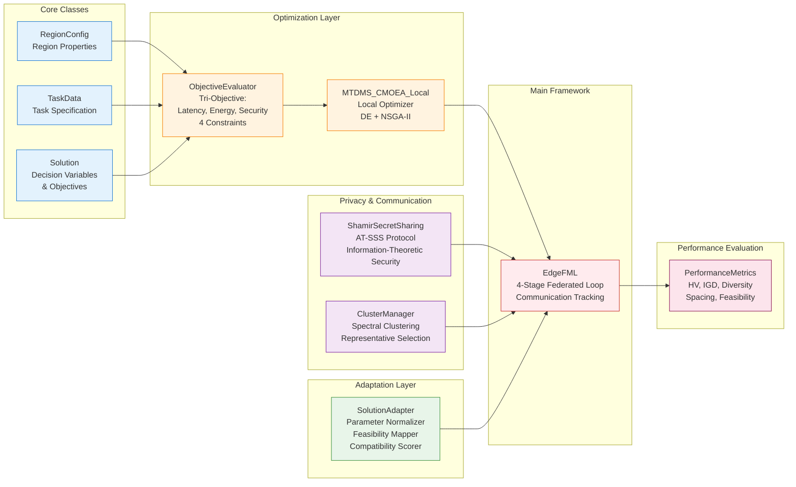

# Edge-FML Algorithm Structure

## Algorithm Architecture Diagram

```mermaid
graph TB
    Start([Start: Edge-FML Framework]) --> Init[Initialize System]
    
    Init --> Init1[Generate N Edge Regions<br/>with Heterogeneous Characteristics]
    Init --> Init2[Generate Task Sets<br/>for Each Region]
    Init --> Init3[Form Clusters Using<br/>Spectral Clustering]
    
    Init1 --> Cluster[ClusterManager]
    Init3 --> Cluster
    
    Cluster --> Loop{Federated<br/>Round r ≤ R_max?}
    
    %% Stage 1: Local Evolution
    Loop -->|Yes| Stage1[Stage 1: Local Membrane Evolution]
    Stage1 --> S1P1[For Each Region r in Parallel]
    S1P1 --> MTDMS[MTDMS-CMOEA-Local+]
    
    MTDMS --> S1A[Initialize Population<br/>Adaptive Size]
    S1A --> S1B[Evolution Loop<br/>M_local Generations]
    S1B --> S1C{Generation g ≤ M_local?}
    S1C -->|Yes| S1D[Update Dynamic Threshold<br/>θ_r = θ_0 × time_factor × load_factor]
    S1D --> S1E[Generate Offspring<br/>Differential Evolution]
    S1E --> S1F[Environmental Selection<br/>Constrained Dominance]
    S1F --> S1G[Update Elite Archive<br/>Non-dominated Feasible Solutions]
    S1G --> S1C
    S1C -->|No| S1H[Return Elite Solutions E_r]
    
    %% Stage 2: Cluster-Level Exchange
    S1H --> Stage2[Stage 2: Cluster-Level Knowledge Exchange]
    Stage2 --> S2P1[For Each Cluster C_m]
    S2P1 --> S2A[Collect Elites from<br/>All Member Regions]
    S2A --> S2B[Compute Average<br/>Constraint Violations]
    S2B --> S2C[Broadcast Within Cluster<br/>No Encryption]
    S2C --> S2D[Representative Aggregates<br/>Cluster Knowledge]
    
    %% Stage 3: Federated Aggregation
    S2D --> Stage3[Stage 3: Federated Knowledge Aggregation]
    Stage3 --> S3A[Virtual Coordinator Receives<br/>from All Cluster Representatives]
    S3A --> S3B[AT-SSS: Encrypt Knowledge<br/>with Adaptive Threshold]
    S3B --> S3C[Aggregate Constraint Patterns<br/>Filter Significant Violations]
    S3C --> S3D[Select Global Elites<br/>by HV Contribution]
    S3D --> S3E[Distribute to<br/>Cluster Representatives]
    
    %% Stage 4: Local Integration
    S3E --> Stage4[Stage 4: Local Knowledge Integration]
    Stage4 --> S4P1[For Each Region r]
    S4P1 --> S4A[Receive Global Knowledge<br/>from Representative]
    S4A --> S4B[Solution Adaptation]
    
    S4B --> S4C[Parameter Normalizer<br/>Resource Mapping]
    S4C --> S4D[Feasibility Mapper<br/>Constraint Repair]
    S4D --> S4E[Compatibility Scoring<br/>Compat = exp-βRD × 1-CV × Importance]
    S4E --> S4F{Compat ><br/>θ_keep?}
    S4F -->|Yes| S4G[Accept Adapted Solution]
    S4F -->|No| S4H[Reject Solution]
    
    S4G --> S4I[Merge with Local Population]
    S4H --> S4I
    S4I --> S4J[Update Local Population<br/>Environmental Selection]
    
    %% Loop Back
    S4J --> Eval[Evaluate Round Performance<br/>HV, Feasibility Rate]
    Eval --> Loop
    
    %% Final Output
    Loop -->|No| Final[Build Global Pareto Front]
    Final --> Output[Output: Global Elites<br/>Performance Metrics<br/>Communication Stats]
    Output --> End([End])
    
    %% Styling
    classDef stage1 fill:#e1f5ff,stroke:#01579b,stroke-width:2px
    classDef stage2 fill:#fff3e0,stroke:#e65100,stroke-width:2px
    classDef stage3 fill:#f3e5f5,stroke:#4a148c,stroke-width:2px
    classDef stage4 fill:#e8f5e9,stroke:#1b5e20,stroke-width:2px
    classDef component fill:#fff9c4,stroke:#f57f17,stroke-width:2px
    
    class Stage1,S1P1,MTDMS,S1A,S1B,S1C,S1D,S1E,S1F,S1G,S1H stage1
    class Stage2,S2P1,S2A,S2B,S2C,S2D stage2
    class Stage3,S3A,S3B,S3C,S3D,S3E stage3
    class Stage4,S4P1,S4A,S4B,S4C,S4D,S4E,S4F,S4G,S4H,S4I,S4J stage4
    class Cluster,Init1,Init2,Init3 component
```



## Detailed Component Structure



## Data Flow Diagram

```mermaid
sequenceDiagram
    participant User
    participant EdgeFML
    participant Cluster
    participant Region1
    participant Region2
    participant MTDMS
    participant Adapter
    
    User->>EdgeFML: Initialize(regions, tasks, R_max, M_local)
    EdgeFML->>Cluster: Form Clusters
    Cluster-->>EdgeFML: Cluster Assignments
    
    loop For R_max Rounds
        EdgeFML->>Region1: Stage 1: Evolve Locally
        EdgeFML->>Region2: Stage 1: Evolve Locally
        
        Region1->>MTDMS: Run M_local Generations
        MTDMS-->>Region1: Elite Solutions E1
        
        Region2->>MTDMS: Run M_local Generations
        MTDMS-->>Region2: Elite Solutions E2
        
        EdgeFML->>Cluster: Stage 2: Exchange Within Cluster
        Region1->>Cluster: Send E1 (unencrypted)
        Region2->>Cluster: Send E2 (unencrypted)
        Cluster-->>Region1: Cluster Elites
        Cluster-->>Region2: Cluster Elites
        
        EdgeFML->>EdgeFML: Stage 3: Federated Aggregation
        Note over EdgeFML: AT-SSS Encryption<br/>Global Elite Selection
        
        EdgeFML->>Region1: Stage 4: Global Knowledge
        EdgeFML->>Region2: Stage 4: Global Knowledge
        
        Region1->>Adapter: Adapt External Solutions
        Adapter-->>Region1: Compatible Solutions
        
        Region2->>Adapter: Adapt External Solutions
        Adapter-->>Region2: Compatible Solutions
        
        EdgeFML->>EdgeFML: Evaluate Round Performance
    end
    
    EdgeFML-->>User: Global Pareto Front
